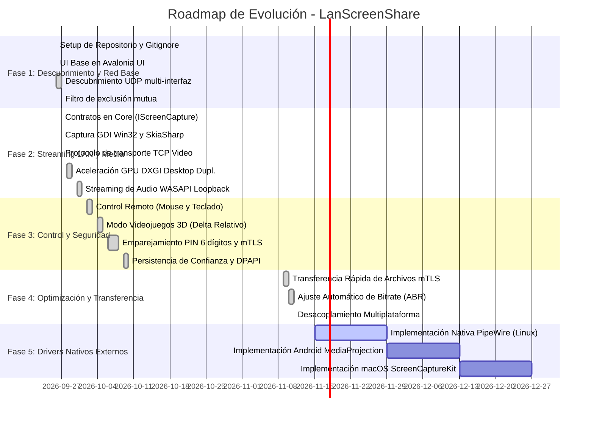

# LanScreenShare - Arquitectura, Roadmap y Diagrama de Clases

Documento de seguimiento técnico, evolución arquitectónica y contratos del proyecto **LanScreenShare**. Este documento refleja fielmente las capacidades implementadas, los contratos de abstracción de red y multimedia, los mecanismos de seguridad criptográfica y la hoja de ruta multiplataforma.

---

## 1. Visión y Objetivos del Proyecto

* **Objetivo principal:** Aplicación ultraligera, segura y de alto rendimiento para compartir pantalla, audio del sistema y control remoto en tiempo real a través de redes locales (LAN) con latencia sub-10ms.
* **Estrategia nativa y aceleración por hardware:**
  * **Windows:** Captura directa GPU mediante DirectX 11 DXGI Output Duplication y Windows Graphics Capture (WGC). Codificación y decodificación por hardware H.264 / NVENC / QuickSync / AMD AMF vía Media Foundation y captura de audio de baja latencia con WASAPI Loopback.
  * **Ajuste Dinámico de Congestión (ABR):** Control de congestión adaptativo en tiempo real basado en algoritmo AIMD (*Additive Increase, Multiplicative Decrease*), gradientes de RTT, degradación defensiva de FPS y solicitudes dinámicas de fotogramas clave (*Instantaneous Decoder Refresh* / IDR).
* **Transferencia Rápida de Archivos:**
  * Canal de alta velocidad dedicado y autenticado mediante **mTLS** (puerto TCP 5004), soporte drag-and-drop en la interfaz, cálculo de integridad SHA-256 en vuelo y transmisión por bloques de 64 KB.
* **Seguridad de Grado Criptográfico:**
  * Emparejamiento por PIN de 6 dígitos, autenticación mutua TLS 1.3/1.2 (mTLS) con certificados efímeros y persistentes ECDSA P-256, almacén de dispositivos de confianza (`TrustedDeviceStore`) y protección de claves privadas vía DPAPI (Windows) o AES-256-GCM (Linux / Android / macOS).
* **Diseño Orientado a Multiplataforma:**
  * Interfaz de usuario construida sobre **Avalonia UI 12.0.2**, compatible de forma nativa con **Windows, Linux, macOS, Android e iOS**.
  * Desacoplamiento total de la capa multimedia mediante el patrón *Abstract Factory* (`CaptureServiceFactory`, `AudioServiceFactory`, `IdentityKeyStorageFactory`), permitiendo la compilación y ejecución segura en cualquier sistema operativo sin dependencias rígidas de Win32.

---

## 2. Tecnologías y Herramientas Utilizadas

| Componente | Tecnología | Justificación y Rol en la Arquitectura |
| :--- | :--- | :--- |
| **Plataforma base** | .NET 9.0 (C# 13) | Alto rendimiento, manejo eficiente de memoria asincrónica (`Span<T>`, `Memory<T>`, `ArrayPool<byte>`). |
| **Interfaz de Usuario** | Avalonia UI 12.0.2 (Fluent Theme) | Framework XAML multiplataforma de alto rendimiento con renderizado acelerado por GPU (SkiaSharp). |
| **Descubrimiento LAN** | Sockets UDP (`System.Net.Sockets`) | Broadcast dirigido por subred (`Subnet Directed Broadcast`, ej. `192.168.1.255`) con aislamiento de adaptadores virtuales y auto-filtrado. |
| **Seguridad de Transporte** | TLS 1.3 / mTLS (`SslStream`) | Canales de control y transferencia de archivos cifrados con autenticación mutua de certificados ECDSA P-256 y validación de huella (*thumbprint pinning*). |
| **Almacenamiento de Claves** | DPAPI (Win) / AES-256-GCM (Cross-Platform) | Protección en reposo de certificados de identidad con permisos estrictos de sistema de archivos (`0600`). |
| **Captura GPU (Windows)** | DirectX 11 DXGI Output Duplication | Captura de fotogramas directo desde la VRAM a 60 FPS con latencia inferior a 2ms e impacto despreciable en CPU. |
| **Captura de Ventanas** | Win32 GDI & Windows Graphics Capture | Captura granular de pantallas completas o ventanas individuales incluso cuando están solapadas o minimizadas. |
| **Captura Universal (Cross-Platform)** | `CrossPlatformScreenCaptureService` | Pipeline desacoplado que genera fotogramas sintéticos/test-card para entornos Linux/Android o pipelines de CI/CD. |
| **Códecs de Video** | H.264 Hardware / JPEG SkiaSharp | Codificación por GPU (Media Foundation H.264) para mínimo consumo de ancho de banda y compresión JPEG paralela como fallback. |
| **Streaming de Audio** | WASAPI Loopback / NAudio | Captura nativa de mezcla estéreo de altavoces y aislamiento selectivo de audio por proceso o aplicación específica. |
| **Audio Universal (Cross-Platform)** | `NullAudioCaptureService` / `Player` | Implementaciones nulas seguras para plataformas sin subsistema WASAPI, garantizando estabilidad total sin excepciones de plataforma. |
| **Control de Congestión (ABR)**| `AdaptiveBitrateController` (AIMD) | Ajuste dinámico de bitrate en tiempo real (2 a 50 Mbps), escala defensiva de FPS (60 → 45 → 30) y recuperación automática de pérdidas. |
| **Simulación de Entrada** | Win32 `SendInput` / `NullInputSimulator` | Inyección de ratón, teclado relativo 3D (para videojuegos) y sincronización de portapapeles. |
| **Transferencia de Archivos** | `FileTransferServer` / `Client` (mTLS) | Protocolo binario streaming en bloques de 64 KB con hash SHA-256 y soporte drag-and-drop integrado. |

---

## 3. Estado de Hitos del Roadmap

---

## 4. Resumen Detallado de Módulos Implementados

### 4.1. Transferencia Rápida de Archivos LAN (mTLS - Puerto 5004)
* **Arquitectura de Streaming por Bloques:** Implementado en `LanScreenShare.Network/FileTransferServer.cs` y `FileTransferClient.cs`. Utiliza un protocolo binario estructurado con números mágicos (`LSFT`), transmisión de metadatos en JSON y transporte de bloques de datos de 64 KB (`ArrayPool<byte>`).
* **Seguridad de Transferencia:** El canal corre sobre mTLS mutuo requiriendo que emisor y receptor validen sus certificados de identidad ECDSA P-256 antes de transmitir cualquier byte.
* **Integridad Criptográfica en Vuelo:** Cálculo simultáneo del hash SHA-256 en emisor y receptor con verificación final estricta para garantizar que el archivo recibido no sufrió corrupción.
* **Experiencia de Usuario:** Arrastrar y soltar archivos (*Drag and Drop*) directamente sobre la ventana de transmisión con barra de progreso reactiva, tasa de transferencia en MB/s y botón de cancelación instantánea.

### 4.2. Control Dinámico de Congestión y Tasa de Bits Adaptativa (ABR)
* **Algoritmo AIMD en Tiempo Real:** Implementado en `LanScreenShare.Core/Services/AdaptiveBitrateController.cs`. Evalúa métricas continuas de latencia de ida y vuelta (RTT), tiempo de codificación y tasa de pérdida de paquetes.
* **Métricas y Gradientes:**
  * **RTT < 25ms y sin pérdidas:** Incremento aditivo gradual (+1 Mbps o +2 Mbps) hasta el máximo configurado (ej. 35 Mbps).
  * **RTT 25ms - 50ms:** Región de estabilidad óptima; preserva bitrate.
  * **RTT 50ms - 90ms:** Congestión incipiente; aplica reducción preventiva multiplicativa (ej. $\times 0.85$).
  * **RTT > 90ms o pérdidas sostenidas:** Reducción agresiva ($\times 0.70$) con fallback defensivo de fotogramas por segundo (60 FPS → 45 FPS → 30 FPS) y emisión inmediata de solicitud de *Keyframe* (I-Frame) al capturador.
* **Integración en UI:** Telemetría en vivo en la barra de estado (`• ABR: 18 Mbps ⚡`), selector de activación en caliente y configuración persistente en `AppSettings`.

### 4.3. Desacoplamiento y Soporte Multiplataforma
* **Almacén Criptográfico Universal (`CrossPlatformIdentityKeyStorage`):** Almacenamiento seguro de claves privadas X.509 en Linux, Android y macOS mediante **AES-256-GCM** y derivación PBKDF2/HMAC-SHA256, con permisos de lectura/escritura restringidos exclusivamente al usuario actual (`0600`).
* **Fábricas de Servicios:**
  * `IdentityKeyStorageFactory`: Selecciona DPAPI en Windows y AES-256-GCM en otros sistemas operativos.
  * `CaptureServiceFactory`: Instancia DXGI o GDI en Windows, y `CrossPlatformScreenCaptureService` en Linux/macOS/Android.
  * `AudioServiceFactory`: Instancia WASAPI Loopback en Windows, y `NullAudioCaptureService` / `NullAudioPlayerService` en otras plataformas.
* **Simulación de Entrada Agnóstica:** `NullInputSimulatorService` evita caídas o excepciones de plataforma en clientes o hosts ejecutados fuera de Windows.

---

## 5. Diagrama de Clases Integral de la Arquitectura

```mermaid
classDiagram
    %% =======================
    %% CAPA CORE
    %% =======================
    namespace LanScreenShare_Core {
        class DeviceInfo {
            +string Name
            +string IPAddress
            +DateTime LastSeen
        }

        class CapturedFrame {
            +byte[] Data
            +int Width
            +int Height
            +long Timestamp
            +string Format
            +int HostFps
            +int HostFrameTimeMs
        }

        class CapturedAudioChunk {
            +byte[] Data
            +int SampleRate
            +int Channels
            +int BitsPerSample
            +short AudioFormat
            +long Timestamp
        }

        class RemoteInputMessage {
            +InputEventType Type
            +float NormalizedX
            +float NormalizedY
            +RemoteMouseButton Button
            +short WheelDelta
            +int KeyCode
            +string ClipboardText
        }

        class FileMetadata {
            +string TransferId
            +string FileName
            +long FileSizeBytes
            +string Sha256Hash
            +int ChunkSizeBytes
        }

        class IScreenCaptureService {
            <<interface>>
            +bool IsCapturing
            +int TargetFps
            +int Quality
            +int BitrateMbps
            +double ResolutionScale
            +StartCapture(int, int, double, string, int, int, int) void
            +StopCapture() void
            +UpdateSettings(int, int, double, string, int, int, int) void
            +RequestKeyframe() void
            +event FrameCaptured
        }

        class IAudioCaptureService {
            <<interface>>
            +bool IsCapturing
            +StartCapture() void
            +StartCapture(int processId) void
            +StopCapture() void
            +event AudioCaptured
        }

        class IAudioPlayerService {
            <<interface>>
            +bool IsPlaying
            +bool IsMuted
            +float Volume
            +PlayChunk(CapturedAudioChunk) void
            +ClearBuffer() void
            +Stop() void
        }

        class IInputSimulatorService {
            <<interface>>
            +SimulateInput(RemoteInputMessage) void
            +SetTargetSource(CaptureSource) void
            +ReleaseInjectedInputs() void
        }

        class IIdentityKeyStorage {
            <<interface>>
            +GetOrCreateIdentityCertificateAsync() Task~X509Certificate2~
            +ResetIdentityAsync() Task
        }

        class AdaptiveBitrateController {
            +int CurrentBitrateMbps
            +int CurrentFps
            +bool IsAbrEnabled
            +OnFrameSent(long, int) void
            +OnTelemetryReceived(StreamTelemetry) void
            +event BitrateChanged
            +event FpsChanged
            +event KeyframeRequested
        }
    }

    %% =======================
    %% CAPA SEGURIDAD & FACTORIES
    %% =======================
    namespace LanScreenShare_Security {
        class IdentityKeyStorageFactory {
            +Create()$ IIdentityKeyStorage
        }

        class WindowsDpapiIdentityKeyStorage {
            -string _keyStorePath
            +GetOrCreateIdentityCertificateAsync() Task~X509Certificate2~
        }

        class CrossPlatformIdentityKeyStorage {
            -string _storagePath
            +GetOrCreateIdentityCertificateAsync() Task~X509Certificate2~
            -EncryptWithAesGcm(byte[], byte[])$ byte[]
            -DecryptWithAesGcm(byte[], byte[])$ byte[]
        }

        class TrustedDeviceStore {
            +IsDeviceTrusted(string, string) bool
            +TrustDevice(string, string, string) void
            +RevokeDevice(string) void
        }
    }

    %% =======================
    %% CAPA RED
    %% =======================
    namespace LanScreenShare_Network {
        class DiscoveryService {
            +StartHostingBroadcast() void
            +StopHosting() void
            +StartListening() void
            +event OnDeviceDiscovered
        }

        class TcpStreamServer {
            +StartAsync(int port, CancellationToken) Task
            +BroadcastFrameAsync(CapturedFrame) Task
            +Stop() void
        }

        class TcpStreamClient {
            +ConnectAsync(string, int, CancellationToken) Task
            +event FrameReceived
            +event TelemetryUpdated
        }

        class FileTransferServer {
            +StartAsync(int port, X509Certificate2, CancellationToken) Task
            +Stop() void
            +event FileReceived
        }

        class FileTransferClient {
            +SendFileAsync(string, string, int, X509Certificate2, IProgress) Task
        }
    }

    %% =======================
    %% CAPA MULTIMEDIA
    %% =======================
    namespace LanScreenShare_Media {
        class CaptureServiceFactory {
            +Create(CaptureSource, string)$ IScreenCaptureService
        }

        class AudioServiceFactory {
            +CreateAudioCapture()$ IAudioCaptureService
            +CreateMicCapture()$ IAudioCaptureService
            +CreateAudioPlayer()$ IAudioPlayerService
        }

        class DxgiScreenCaptureService {
            +StartCapture(...) void
            +StopCapture() void
        }

        class WindowsScreenCaptureService {
            +StartCapture(...) void
            +StopCapture() void
        }

        class CrossPlatformScreenCaptureService {
            +StartCapture(...) void
            +StopCapture() void
        }

        class WasapiAudioCaptureService {
            +StartCapture() void
            +StopCapture() void
        }

        class WasapiAudioPlayerService {
            +PlayChunk(CapturedAudioChunk) void
        }

        class NullAudioCaptureService {
            +StartCapture() void
            +StopCapture() void
        }

        class NullAudioPlayerService {
            +PlayChunk(CapturedAudioChunk) void
        }
    }

    %% =======================
    %% CAPA UI
    %% =======================
    namespace LanScreenShare_Desktop {
        class MainWindow {
            -DiscoveryService _discoveryService
            -IScreenCaptureService _screenCaptureService
            -AdaptiveBitrateController _abrController
            -FileTransferServer _fileTransferServer
            -FileTransferClient _fileTransferClient
            -IIdentityKeyStorage _keyStorage
            -IInputSimulatorService _inputSimulator
        }
    }

    %% =======================
    %% RELACIONES
    %% =======================
    IIdentityKeyStorage <|.. WindowsDpapiIdentityKeyStorage
    IIdentityKeyStorage <|.. CrossPlatformIdentityKeyStorage
    IdentityKeyStorageFactory ..> IIdentityKeyStorage : genera

    IScreenCaptureService <|.. DxgiScreenCaptureService
    IScreenCaptureService <|.. WindowsScreenCaptureService
    IScreenCaptureService <|.. CrossPlatformScreenCaptureService
    CaptureServiceFactory ..> IScreenCaptureService : genera

    IAudioCaptureService <|.. WasapiAudioCaptureService
    IAudioCaptureService <|.. NullAudioCaptureService
    IAudioPlayerService <|.. WasapiAudioPlayerService
    IAudioPlayerService <|.. NullAudioPlayerService
    AudioServiceFactory ..> IAudioCaptureService : genera
    AudioServiceFactory ..> IAudioPlayerService : genera

    MainWindow --> AdaptiveBitrateController : consulta y sincroniza
    MainWindow --> FileTransferServer : aloja
    MainWindow --> FileTransferClient : ejecuta envíos
    MainWindow --> IdentityKeyStorageFactory : obtiene almacén criptográfico
    MainWindow --> CaptureServiceFactory : crea capturador
    MainWindow --> AudioServiceFactory : crea audio
```

---

## 6. Hoja de Ruta para Próximas Fases (Drivers Nativos Específicos)

Con la arquitectura completamente desacoplada mediante fábricas abstractas y contratos agnósticos, las siguientes implementaciones específicas de sistema operativo pueden integrarse de manera limpia y modular sin alterar el flujo principal de la aplicación:

1. **Linux (PipeWire / Wayland / X11):**
   - Implementación de `PipeWireScreenCaptureService` conectándose al portal D-Bus `org.freedesktop.portal.ScreenCast`.
   - Captura de audio del sistema a través de PulseAudio / PipeWire ALSA loopback.
2. **Android (API 29+):**
   - Implementación de `AndroidMediaProjectionService` utilizando `MediaProjection` y `VirtualDisplay` renderizado hacia `Surface`.
   - Adquisición de `WifiManager.MulticastLock` en el ciclo de vida del servicio de descubrimiento UDP.
3. **macOS (ScreenCaptureKit):**
   - Implementación de `MacScreenCaptureKitService` utilizando las APIs nativas de alta eficiencia de macOS 12.3+ (`SCStream` y `SCContentFilter`).
