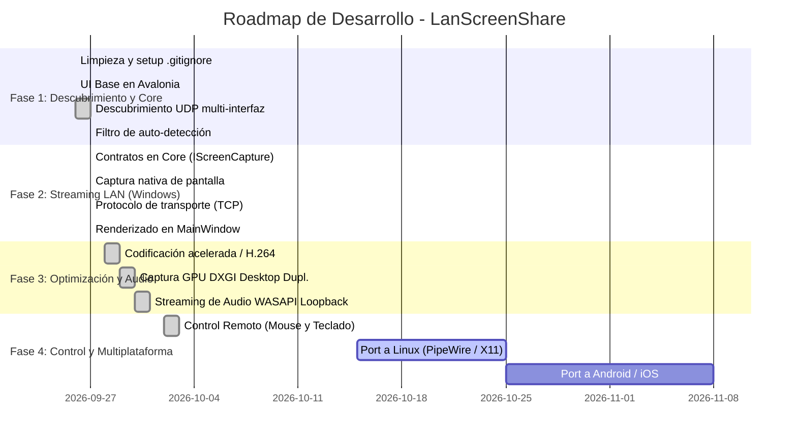

# LanScreenShare - Arquitectura, Roadmap y Diagrama de Clases

Documento de seguimiento técnico y evolución del proyecto. Este archivo debe actualizarse conforme se implementen nuevas características o se modifiquen contratos de arquitectura.

---

## 1. Visión y Objetivos del Proyecto

* **Objetivo principal:** Aplicación ligera y de alto rendimiento para compartir y visualizar pantalla en tiempo real a través de redes locales (LAN) con latencia mínima.
* **Estrategia nativa:** En Windows, aprovechar las APIs nativas del sistema (`Windows.Graphics.Capture`, DXGI, Media Foundation) sin exigir a los usuarios herramientas externas pesadas (como OBS o ejecutables ffmpeg independientes).
* **Diseño orientado a Multiplataforma:** 
  * Interfaz construida sobre **Avalonia UI**, lo que permite compilar la misma UI en **Windows, Linux, macOS, Android e iOS**.
  * Arquitectura desacoplada en la capa multimedia: contratos comunes en `LanScreenShare.Core` e implementaciones de captura/renderizado específicas por sistema operativo en `LanScreenShare.Media`.

---

## 2. Tecnologías y Herramientas Utilizadas

| Componente | Tecnología | Justificación |
| :--- | :--- | :--- |
| **Plataforma base** | .NET 9.0 (C#) | Alto rendimiento, manejo eficiente de memoria asincrónica (`Span<T>`, `Memory<T>`). |
| **Interfaz de Usuario** | Avalonia UI 12.0.2 | Framework XAML multiplataforma nativo compatible con escritorio y móviles. |
| **Descubrimiento LAN** | Sockets UDP (`System.Net.Sockets`) | Broadcast dirigido por subred física (ej. `192.168.100.255`) para rápida detección entre pares. |
| **Control de versiones** | Git + `.gitignore` completo | Repositorio limpio sin artefactos binarios (`bin/`, `obj/`, `.vs/`). |
| **Captura en Windows (Objetivo)** | `Windows.Graphics.Capture` / DXGI | Captura acelerada por GPU integrada en Windows 10/11 sin latencia de CPU. |
| **Captura en Linux (Futuro)** | PipeWire / X11 XComposite | Estándar moderno de captura de escritorio en entornos Linux. |
| **Captura en Android (Futuro)** | `MediaProjection API` | API nativa de Android para transmisión de pantalla. |

---

## 3. Estado de Hitos



### ✅ Hitos Completados (Fases 1 y 2)
- [x] **Configuración del Repositorio:** Creación de `.gitignore` exhaustivo y purga del índice remoto de carpetas `bin/`, `obj/` y `.vs/`.
- [x] **Modelos Base:** Creación del modelo `DeviceInfo` y `CapturedFrame`.
- [x] **Servicio de Descubrimiento UDP:**
  - Envío periódico a través de broadcast dirigido por subred (`Subnet Directed Broadcast`).
  - Soporte multi-interfaz (aislando interfaces virtuales de VMware, VPNs y Loopback).
  - Manejo de exclusión mutua para evitar auto-descubrimiento en la misma máquina (`IsSelfMessage`).
- [x] **Contratos de Streaming en `LanScreenShare.Core`:**
  - `IScreenCaptureService` (captura agnóstica de plataforma).
  - `IStreamServer` (servidor de emisión de cuadros).
  - `IStreamClient` (receptor y cliente de cuadros).
  - `CapturedFrame` (búfer de imagen, dimensiones, timestamp y formato).
- [x] **Captura de Pantalla Nativa en `LanScreenShare.Media` (Windows):**
  - Implementación en `WindowsScreenCaptureService` utilizando Win32 GDI Desktop Capture (`BitBlt` con soporte de cursor y ventanas transparentes).
  - Compresión de fotogramas ultrarrápida a JPEG mediante SkiaSharp.
- [x] **Protocolo de Streaming en `LanScreenShare.Network`:**
  - `TcpStreamServer`: Servidor TCP con encabezado estructurado de 24 bytes (Magic `LSS1`, longitud, resolución, timestamp).
  - `TcpStreamClient`: Cliente TCP con deserialización de cuadros y reconexión limpia.
- [x] **Renderizado en Tiempo Real en `LanScreenShare.Desktop`:**
  - Integración en `MainWindow.axaml` con control `Image` y decodificación asincrónica en Avalonia `Bitmap`.
  - Estados de conexión (transmitiendo, viendo pantalla de par, desconectado, indicador LED de estado).
- [x] **Ajuste Dinámico de Calidad, FPS y Resolución (Fase 3):**
  - Controles interactivos en UI (Selector de FPS: 15/30/60, Slider de Calidad JPEG: 30% a 95%, Selector de escala de resolución: 100%/75%/50%).
  - Aplicación en caliente sin reiniciar la transmisión (`IScreenCaptureService.UpdateSettings`).
  - Redimensionamiento acelerado por SkiaSharp (`SKSamplingOptions.Default`).
  - Badge de métricas en tiempo real en la barra de transmisión (`FPS` reales, tasa en `KB/s` / `MB/s`, resolución y motor activo).
- [x] **Captura Acelerada por GPU vía DirectX 11 DXGI Desktop Duplication (Fase 3):**
  - Implementación en `DxgiScreenCaptureService` utilizando Direct3D 11 y Vortice.Direct3D11 / DXGI.
  - Tasa de fotogramas fluida a 60 FPS con mínimo impacto en CPU.
  - Detección y recreación automática de duplicación ante cambios de modo o pérdida de acceso (`DXGI_ERROR_ACCESS_LOST`).
  - Superposición antialiasing del cursor del mouse sobre fotograma mapeado.
  - Selector de motor en UI (`DirectX DXGI GPU` o `GDI BitBlt CPU`) con cambio en caliente durante la transmisión.
- [x] **Streaming de Audio del Sistema en Tiempo Real (WASAPI Loopback):**
  - Modelo `CapturedAudioChunk` e interfaces `IAudioCaptureService` / `IAudioPlayerService` en Core.
  - `WasapiAudioCaptureService`: Captura del audio de altavoces/auriculares mediante `WasapiLoopbackCapture` de Windows.
  - `WasapiAudioPlayerService`: Reproductor de baja latencia (buffer dinámico de 25ms y control de volumen/muteo) con `WasapiOut`.
  - Protocolo TCP de audio independiente (`TcpAudioServer` y `TcpAudioClient` en puerto 5002) con Magic binario `LSA1`.
  - Controles integrados en UI: Checkbox de transmisión de audio y botón interactivo de silenciamiento (`🔊` / `🔇`).

---

- [x] **Control Remoto Interactivo de Mouse y Teclado (Fase 4):**
  - Modelo `RemoteInputMessage` con coordenadas normalizadas (0.0f a 1.0f), clics, rueda de desplazamiento y códigos de teclas virtuales.
  - `WindowsInputSimulatorService` (`user32.dll` `SendInput`) con soporte multi-monitor (`MOUSEEVENTF_VIRTUALDESK`).
  - Protocolo TCP de baja latencia (`TcpControlServer` y `TcpControlClient` en puerto 5003 con cabecera binaria `LSI1` de 20 bytes).
  - Cálculo geométrico preciso en `MainWindow.axaml.cs` para compensar franjas negras (*letterboxing/pillarboxing*) del control `Image` con `Stretch="Uniform"`.
  - Controles de seguridad: Casilla *"Permitir control remoto"* en el host y botón interactivo `🎮 Control` en la barra del espectador.

---

### ⏳ Siguientes Pasos (Fase 4: Multiplataforma y Empaquetado)

1. **Port a Linux (PipeWire / X11) y Móviles (Android / iOS):**
   - Abstracción de captura de escritorio mediante PipeWire / X11 XComposite en Linux.
   - Adaptador para `MediaProjection` en Android.

---

## 4. Diagrama de Clases y Arquitectura

El siguiente diagrama refleja la estructura implementada:

```mermaid
classDiagram
    %% Capa Core
    namespace LanScreenShare_Core {
        class DeviceInfo {
            +string Name
            +string IPAddress
            +DateTime LastSeen
        }

        class CapturedFrame {
            +byte[] Data
            +int Width
            +int Height
            +long Timestamp
            +string Format
        }

        class CapturedAudioChunk {
            +byte[] Data
            +int SampleRate
            +int Channels
            +int BitsPerSample
            +short AudioFormat
            +long Timestamp
        }

        class RemoteInputMessage {
            +InputEventType Type
            +float NormalizedX
            +float NormalizedY
            +RemoteMouseButton Button
            +short WheelDelta
            +int KeyCode
        }

        class IInputSimulatorService {
            <<interface>>
            +SimulateInput(RemoteInputMessage) void
        }

        class IScreenCaptureService {
            <<interface>>
            +bool IsCapturing
            +int TargetFps
            +int Quality
            +double ResolutionScale
            +StartCapture(int, int, double) void
            +StopCapture() void
            +UpdateSettings(int, int, double) void
            +event FrameCaptured
        }

        class IAudioCaptureService {
            <<interface>>
            +bool IsCapturing
            +StartCapture() void
            +StopCapture() void
            +event AudioCaptured
        }

        class IAudioPlayerService {
            <<interface>>
            +bool IsPlaying
            +bool IsMuted
            +float Volume
            +PlayChunk(CapturedAudioChunk) void
            +Stop() void
        }
            +StopCapture() void
            +event FrameCaptured
        }

        class IStreamServer {
            <<interface>>
            +bool IsRunning
            +int ConnectedClientsCount
            +StartAsync(int port, CancellationToken) Task
            +BroadcastFrameAsync(CapturedFrame) Task
            +Stop() void
            +event ClientConnected
            +event ClientDisconnected
        }

        class IStreamClient {
            <<interface>>
            +bool IsConnected
            +ConnectAsync(string hostIp, int port, CancellationToken) Task
            +DisconnectAsync() Task
            +event FrameReceived
            +event StatusChanged
        }
    }

    %% Capa Red
    namespace LanScreenShare_Network {
        class DiscoveryService {
            -int DiscoveryPort
            -string BroadcastMessagePrefix
            +StartHostingBroadcast() void
            +StopHosting() void
            +StartListening() void
            +StopListening() void
            +event OnDeviceDiscovered
        }

        class TcpStreamServer {
            -TcpListener _listener
            -ConcurrentDictionary _clients
            +StartAsync(int port, CancellationToken) Task
            +BroadcastFrameAsync(CapturedFrame frame) Task
            +Stop() void
        }

        class TcpStreamClient {
            -TcpClient _client
            +ConnectAsync(string hostIp, int port, CancellationToken) Task
            +DisconnectAsync() Task
            +event FrameReceived
        }

        class TcpAudioServer {
            -TcpListener _listener
            +StartAsync(int port, CancellationToken) Task
            +BroadcastAudioAsync(CapturedAudioChunk) Task
            +Stop() void
        }

        class TcpAudioClient {
            -TcpClient _client
            +ConnectAsync(string hostIp, int port, CancellationToken) Task
            +DisconnectAsync() Task
            +event AudioReceived
        }

        class TcpControlServer {
            -TcpListener _listener
            +StartAsync(int port, CancellationToken) Task
            +event InputReceived
            +Stop() void
        }

        class TcpControlClient {
            -TcpClient _client
            +ConnectAsync(string hostIp, int port, CancellationToken) Task
            +SendInputAsync(RemoteInputMessage) Task
            +DisconnectAsync() Task
        }
    }

    %% Capa Media (Específica por SO)
    namespace LanScreenShare_Media {
        class WindowsScreenCaptureService {
            -bool _isCapturing
            -CancellationTokenSource _cts
            +StartCapture(int targetFps, int quality, double resolutionScale) void
            +StopCapture() void
            +UpdateSettings(int targetFps, int quality, double resolutionScale) void
            -CaptureDesktopFrame(int quality, double scale) CapturedFrame
            -DrawMouseCursor(IntPtr, int, int)$ void
        }

        class DxgiScreenCaptureService {
            -bool _isCapturing
            -CancellationTokenSource _cts
            +StartCapture(int targetFps, int quality, double resolutionScale) void
            +StopCapture() void
            +UpdateSettings(int targetFps, int quality, double resolutionScale) void
            -CaptureLoop(CancellationToken) void
            -EncodeFrameFromPointer(IntPtr, int, int, int, int, double, int, int) CapturedFrame
            -DrawCursorOnBitmap(SKBitmap, int, int)$ void
        }

        class WasapiAudioCaptureService {
            -WasapiLoopbackCapture _capture
            +StartCapture() void
            +StopCapture() void
            +event AudioCaptured
        }

        class WasapiAudioPlayerService {
            -WasapiOut _wasapiOut
            -BufferedWaveProvider _waveProvider
            +PlayChunk(CapturedAudioChunk) void
            +Stop() void
        }

        class WindowsInputSimulatorService {
            +SimulateInput(RemoteInputMessage) void
            -SendMouseMove(float, float)$ void
            -SendMouseButton(RemoteMouseButton, bool, float, float)$ void
            -SendMouseWheel(short, float, float)$ void
            -SendKeyboard(int, bool)$ void
        }

        class LinuxPipeWireCaptureService {
            <<futuro>>
            +StartCapture(int, int) void
            +StopCapture() void
        }

        class AndroidMediaProjectionCaptureService {
            <<futuro>>
            +StartCapture(int, int) void
            +StopCapture() void
        }
    }

    %% Capa UI (Avalonia)
    namespace LanScreenShare_Desktop {
        class MainWindow {
            -DiscoveryService _discoveryService
            -IScreenCaptureService _screenCaptureService
            -IStreamServer _streamServer
            -IStreamClient _streamClient
            +ObservableCollection~DeviceInfo~ Devices
            -HostButton_Click(object, RoutedEventArgs) void
            -SearchButton_Click(object, RoutedEventArgs) void
            -ConnectDevice_Click(object, RoutedEventArgs) void
            -DisconnectButton_Click(object, RoutedEventArgs) void
            -StreamClient_FrameReceived(object, CapturedFrame) void
        }

        class App {
            +Initialize() void
            +OnFrameworkInitializationCompleted() void
        }

        class Program {
            +Main(string[] args)$ void
            +BuildAvaloniaApp()$ AppBuilder
        }
    }

    %% Relaciones e Implementaciones
    IScreenCaptureService <|.. DxgiScreenCaptureService : implementa Windows (GPU)
    IScreenCaptureService <|.. WindowsScreenCaptureService : implementa Windows (GDI)
    IScreenCaptureService <|.. LinuxPipeWireCaptureService : implementa Linux (futuro)
    IScreenCaptureService <|.. AndroidMediaProjectionCaptureService : implementa Android (futuro)

    IStreamServer <|.. TcpStreamServer : implementa emisor video
    IStreamClient <|.. TcpStreamClient : implementa receptor video
    IAudioCaptureService <|.. WasapiAudioCaptureService : implementa captura audio Windows
    IAudioPlayerService <|.. WasapiAudioPlayerService : implementa reproductor audio Windows
    IInputSimulatorService <|.. WindowsInputSimulatorService : implementa simulación entrada Windows

    MainWindow --> DiscoveryService : usa
    MainWindow --> IScreenCaptureService : usa
    MainWindow --> IStreamServer : emite frames video
    MainWindow --> IStreamClient : recibe frames video
    MainWindow --> IAudioCaptureService : captura audio
    MainWindow --> IAudioPlayerService : reproduce audio
    MainWindow --> TcpAudioServer : emite audio
    MainWindow --> TcpAudioClient : recibe audio
    MainWindow --> TcpControlServer : recibe eventos control
    MainWindow --> TcpControlClient : emite eventos control
    MainWindow --> IInputSimulatorService : inyecta input host
    MainWindow ..> CapturedFrame : renderiza en Image
    MainWindow ..> CapturedAudioChunk : reproduce en audio buffer
    MainWindow ..> RemoteInputMessage : envía / recibe interacción

    WindowsScreenCaptureService ..> CapturedFrame : produce
    DxgiScreenCaptureService ..> CapturedFrame : produce
    WasapiAudioCaptureService ..> CapturedAudioChunk : produce
    WindowsInputSimulatorService ..> RemoteInputMessage : procesa
    TcpStreamServer ..> CapturedFrame : transporta
    TcpStreamClient ..> CapturedFrame : recibe
    TcpAudioServer ..> CapturedAudioChunk : transporta
    TcpAudioClient ..> CapturedAudioChunk : recibe
    TcpControlServer ..> RemoteInputMessage : recibe
    TcpControlClient ..> RemoteInputMessage : envía
```

---

## 5. Consideraciones para Móviles y Linux

1. **Aislamiento de Plataforma:**
   - Ningún proyecto debe tener referencias a APIs de Windows excepto `LanScreenShare.Media` (mediante directivas `#if WINDOWS` o proyectos satélite como `LanScreenShare.Media.Windows`, `LanScreenShare.Media.Linux`, `LanScreenShare.Media.Android`).
   - `LanScreenShare.Core`, `LanScreenShare.Network` y `LanScreenShare.Desktop` se mantienen 100% agnósticos del sistema operativo.
2. **Avalonia en Android / iOS:**
   - La arquitectura de vistas (`Views` / `UserControls`) debe separarse de las ventanas (`Window`), ya que en móviles se utiliza `SingleViewApplicationLifetime` en lugar de `ClassicDesktopStyleApplicationLifetime`.
3. **Manejo de Red en Móviles:**
   - En Android, los sockets UDP de broadcast requieren solicitar explícitamente el bloqueo de multicast (`WifiManager.MulticastLock`). Esto se incorporará en el ciclo de vida del adaptador móvil.
