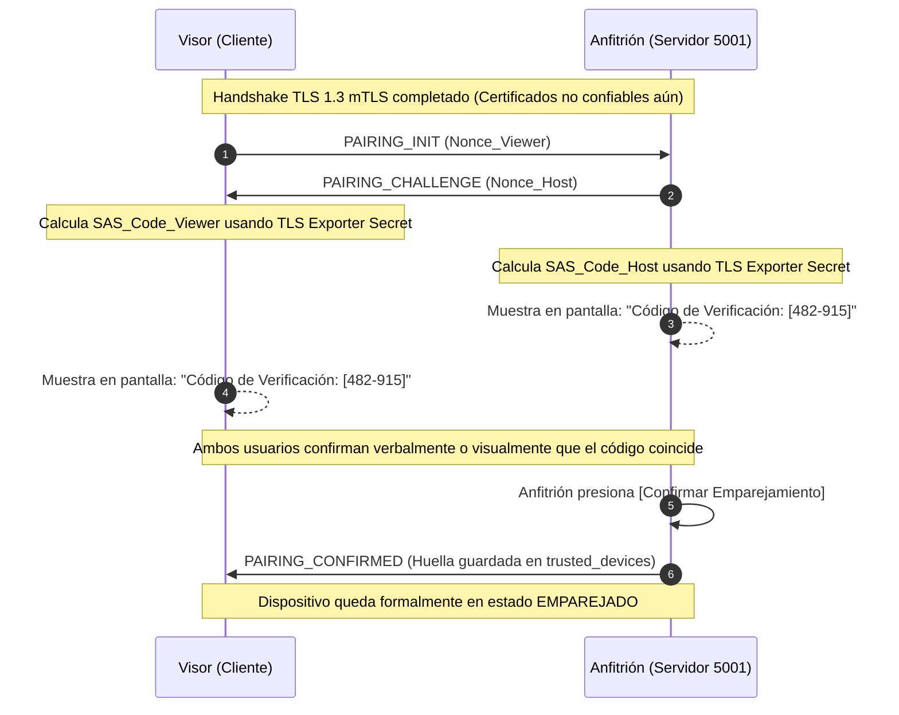

# ADR-001: Arquitectura de Seguridad de Sesión, Autenticación Mutua (mTLS) y Emparejamiento en LanScreenShare

* **Estado:** Propuesto (Revisión 2 — Protocolo Completo y Especificación Rigurosa)
* **Fecha:** 2026-11-04
* **Rama:** `feature/ui-and-architecture-refinement`
* **Módulos afectados:** `LanScreenShare.Core`, `LanScreenShare.Network`, `LanScreenShare.Desktop`
* **Decisores:** Equipo de Arquitectura de LanScreenShare

---

## 1. Contexto y Problema

LanScreenShare opera mediante una topología de red local multi-puerto sobre TCP/UDP:
* **Puerto 5000 (UDP):** Descubrimiento y anuncio de presencia en la subred.
* **Puerto 5001 (TCP):** Transmisión de vídeo (fotogramas H.264 / JPEG con encabezado binario de 32 bytes).
* **Puerto 5002 (TCP):** Transmisión de audio (muestras PCM sin comprimir).
* **Puerto 5003 (TCP):** Control remoto bidireccional (eventos de ratón y teclado inyectados en Windows mediante `SendInput`).

### Vulnerabilidades del Modelo Actual
1. **Canales TCP huérfanos y desvinculados:** Cada puerto escucha de forma independiente. No existe correlación criptográfica entre los sockets. Un cliente puede conectarse a 5003 sin estar conectado a 5001 ni 5002.
2. **Ausencia de autenticación e integridad en el transporte:** El tráfico viaja en texto claro sin cifrado TLS. Cualquier dispositivo en la LAN con un analizador de red puede capturar la pantalla y el micrófono del anfitrión.
3. **Identificación efímera y falsificable:** La identidad del cliente se reduce a la cadena `RemoteEndPoint` (`IP:puerto`). La aprobación visual en UI aprueba una dirección IP, pero no autentica la identidad criptográfica del par.
4. **Falta de exclusividad de control:** Si dos clientes acceden a 5003, ambos pueden emitir `SendInput` simultáneamente, provocando colisiones impredecibles en el escritorio.
5. **Riesgo de entradas atascadas:** La desconexión intempestiva del controlador puede dejar teclas modificadoras o botones de ratón presionados en el sistema operativo del anfitrión.

---

## 2. Modelo de Amenazas y Alcance

### 2.1 Amenazas Contempladas y Mitigadas
| Vector de Amenaza | Descripción | Mitigación en este ADR |
| :--- | :--- | :--- |
| **T1: Suplantación de identidad (Spoofing)** | Un equipo de la LAN finge ser un visor legítimo o suplanta su dirección IP mediante ARP spoofing. | Certificados X.509 por dispositivo con mTLS 1.3 y emparejamiento con *Certificate Pinning* de huella canónica SHA-256. |
| **T2: Interceptación y espionaje (Eavesdropping)** | Un tercero en la misma red Wi-Fi/cableada captura paquetes de vídeo o audio. | Cifrado obligatorio TLS 1.3 con conjuntos de cifrado modernos (`TLS_AES_256_GCM_SHA384`, `TLS_CHACHA20_POLY1305_SHA256`). |
| **T3: Conexión de control no autorizada** | Un atacante se conecta directamente al puerto 5003 sin pasar por el flujo de vídeo para inyectar entradas. | El puerto 5003 no admite datos sin presentar un `ChannelAttachmentToken` atómico de un solo uso derivado de una sesión mTLS autorizada. |
| **T4: Ataque de repetición (Replay)** | Reenvío de paquetes de control capturados para ejecutar comandos no deseados. | Números de secuencia monotónicos `ulong` por sesión y protección anti-replay inherente de TLS 1.3. |
| **T5: Confusión de sesión multicliente** | Eventos de múltiples visores entremezclados en el control del anfitrión. | Principio de *Single Active Controller* (exclusividad estricta garantizada por bloqueo atómico). |
| **T6: Man-in-the-Middle (MitM) en primer contacto** | Sustitución de identidad durante el descubrimiento o emparejamiento inicial. | Protocolo SAS de 6 dígitos derivado criptográficamente del **TLS Exporter Master Secret** y comparado fuera de banda. |

### 2.2 Amenazas Fuera de Alcance (Out of Scope)
* **Endpoints comprometidos:** Si el visor emparejado contiene malware o un troyano con acceso a su clave privada, este ADR no puede distinguir comandos legítimos del usuario de comandos inyectados por el malware en ese visor.
* **Acceso físico al anfitrión:** Si un atacante tiene acceso físico al teclado y pantalla del anfitrión, puede aprobar solicitudes o manipular la configuración local.
* **Ataques a nivel de kernel:** Restricciones de UIPI o anti-cheats a nivel de Ring 0 en Windows exceden las capacidades del protocolo de red de LanScreenShare.

---

## 3. Decisión Arquitectónica: Estándares y Autoridad Central

1. **Transporte Seguro Estándar (TLS 1.3 mTLS):**
   * Se rechaza expresamente diseñar criptografía propietaria o protocolos HMAC por paquete caseros.
   * Todos los puertos TCP (5001, 5002, 5003) negocian obligatoriamente **TLS 1.3 mediante `System.Net.Security.SslStream`**.
   * **Sin Fallback:** Si un cliente intenta conectarse sin ClientHello TLS 1.3, el servidor rechaza y cierra el socket inmediatamente.
2. **Autoridad Central de Sesión (`SessionAuthority`):**
   * Reside en `LanScreenShare.Core`. Es la única entidad facultada para crear, asociar y revocar sesiones.
   * Los servidores TCP no toman decisiones de autorización aisladas; delegan estrictamente en `SessionAuthority`.

---

## 4. Identidad Criptográfica y Ciclo de Vida

### 4.1 Abstracción de Almacenamiento de Claves
Para no acoplar `LanScreenShare.Core` a Windows ni a DPAPI, se define una abstracción:
```csharp
namespace LanScreenShare.Core.Security
{
    public interface IIdentityKeyStorage
    {
        Task<X509Certificate2> GetOrCreateIdentityCertificateAsync();
        Task DeleteIdentityAsync();
    }
}
```
* **Implementación Windows (`WindowsDpapiIdentityKeyStorage`):**
  * Almacena el certificado en `%LocalAppData%\LanScreenShare\security\identity.pfx`.
  * La clave privada se protege mediante **DPAPI** de Windows con `DataProtectionScope.CurrentUser`.
* **Ciclo de vida y contingencias:**
  * **Generación:** Al primer arranque, se genera un par de claves asimétricas **ECDSA (curva secp256r1 / NIST P-256)** con certificado autofirmado X.509v3, vigencia de 2 años, y extensiones `ClientAuth` + `ServerAuth`.
  * **Pérdida de perfil o fallo de descifrado DPAPI:** Si el perfil de Windows se corrompe o cambia de usuario provocando `CryptographicException` al leer el PFX, la aplicación:
    1. Archiva el PFX defectuoso con nombre `identity.pfx.corrupted_{timestamp}`.
    2. Genera una identidad nueva limpia.
    3. Notifica al usuario en la UI que sus emparejamientos previos han quedado invalidados y requerirá un nuevo emparejamiento.
  * **Eliminación y Revocación de Dispositivos:**
    * El anfitrión dispone de un almacén `trusted_devices.json` (cifrado con DPAPI).
    * El usuario puede revocar y borrar cualquier visor con un clic. Al eliminarlo, cualquier sesión activa asociada a su huella se termina inmediatamente en `SessionAuthority`.

---

## 5. Protocolo de Emparejamiento SAS (Prevención Rigurosa de MitM)

Un simple HMAC-SHA256 sobre certificados autofirmados no evita un ataque MitM si el atacante intercepta la conexión y emite sus propios certificados hacia cada extremo. Para garantizar resistencia absoluta contra MitM:

### 5.1 Especificación Matemática del SAS
El código SAS se deriva obligatoriamente del **TLS Exporter Master Secret (RFC 8446, Sección 7.5)** de la conexión TLS 1.3 activa, garantizando que el código dependa intrínsecamente del secreto de sesión negociado:

1. **Extracción del Secreto de Canal:**
   $$\text{ExporterSecret} = \text{SslStream.GetTlsExporter}(\text{label} = \text{"EXPORTER-LanScreenShare-SAS"}, \text{context} = \emptyset, \text{length} = 32)$$
2. **Generación de Nonces de 128 bits:**
   * El anfitrión genera criptográficamente $N_{\text{Host}} \in \{0,1\}^{128}$.
   * El visor genera criptográficamente $N_{\text{Viewer}} \in \{0,1\}^{128}$.
3. **Transcripción Canónica:**
   $$\text{Transcript} = \text{ProtocolVersion (uint32)} \parallel \text{DER}(C_{\text{Host}}) \parallel \text{DER}(C_{\text{Viewer}}) \parallel N_{\text{Host}} \parallel N_{\text{Viewer}}$$
4. **Cálculo del SAS:**
   $$\text{SAS\_Hash} = \text{HMAC-SHA256}(\text{Key} = \text{ExporterSecret}, \text{Message} = \text{Transcript})$$
   $$\text{SAS\_Code} = \text{Int32}(\text{SAS\_Hash}[0..3]) \pmod{1\,000\,000} \quad \text{(Formato: 6 dígitos, ej. 482-915)}$$

### 5.2 Flujo de Validación Humana

* **Protección MitM:** Si un atacante intercepta la conexión, tendrá dos sesiones TLS separadas con secretos de exportador distintos ($\text{ExporterSecret}_1 \neq \text{ExporterSecret}_2$), por lo que los códigos SAS calculados en cada pantalla serán completamente diferentes, alertando a los usuarios de inmediato.
* **Timeout:** Si el emparejamiento no se confirma en 60 segundos, se cancela y se cierra el socket.

---

## 6. Validación Estricta de Certificados en mTLS 1.3

La política en `RemoteCertificateValidationCallback` se ejecuta sin excepciones:
1. **Comprobación de Versión:** Verificar que `SslStream.SslProtocol == SslProtocols.Tls13`.
2. **Cálculo de Huella Canónica:**
   $$\text{Fingerprint} = \text{SHA256}(\text{Certificate.RawData})$$
3. **Comprobación en `IPairedDeviceStore`:**
   * Si el dispositivo está en la lista de revocados o ausente en el almacén de emparejados (y no está en curso un flujo explícito de emparejamiento SAS):
     * El callback retorna `false`.
     * El handshake TLS falla a nivel de capa de transporte y el socket se desconecta de inmediato.

---

## 7. Tokens de Asociación de Canal (`ChannelAttachmentToken`)

Para asociar los puertos 5002 (audio) y 5003 (control) a una sesión sin depender del conocimiento del `SessionId`:

### 7.1 Estructura del Token
```csharp
public sealed record ChannelAttachmentToken(
    string TokenId,             // 128 bits criptográficos en Base64Url
    string SessionId,           // Vinculado unívocamente a la sesión
    string PeerFingerprint,     // Vinculado a la huella del visor mTLS autenticado
    ChannelType AllowedChannel, // Audio (5002) o RemoteControl (5003)
    DateTime ExpiresAt          // 15 segundos exactos desde emisión
);
```

### 7.2 Consumo Atómico y Reglas de Invalidez
* **Consumo atómico:** En `SessionAuthority`, los tokens se resuelven con:
  ```csharp
  if (_attachmentTokens.TryRemove(tokenId, out var token))
  {
      // Validar caducidad, huella y tipo de canal
  }
  ```
  Si dos conexiones TCP intentan usar el mismo token a la vez, solo una puede retirarlo de memoria. La segunda fallará y se cerrará su socket inmediatamente.
* **Incompatibilidad de canal:** Un token expedido para `Audio` es rechazado de inmediato si se presenta en el puerto 5003.
* **Invalidación en Cascada:** Al terminar o revocar la sesión primaria 5001, todos los tokens pendientes de esa sesión son eliminados atómicamente de memoria.

---

## 8. Exclusividad y Revocación Segura de Control Remoto

### 8.1 Garantía de Atomicidad de Controlador Único (*Single Active Controller*)
La asignación de control en `SessionAuthority` es estrictamente atómica para evitar condiciones de carrera:

```csharp
public bool TryAcquireControl(string sessionId, out string? failureReason)
{
    lock (_controlLock)
    {
        if (_activeControllerSessionId != null && _activeControllerSessionId != sessionId)
        {
            failureReason = "ControllerConflict"; // 409
            return false;
        }

        if (!_sessions.TryGetValue(sessionId, out var session) || session.ControlState != RemoteControlState.Granted)
        {
            failureReason = "Unauthorized"; // 401
            return false;
        }

        _activeControllerSessionId = sessionId;
        failureReason = null;
        return true;
    }
}
```

### 8.2 Rastreador de Entradas Inyectadas (`InjectedInputTracker`) y Liberación Segura
> [!CAUTION]
> Queda estrictamente prohibida la emisión indiscriminada de `KEYUP` para modificadores de sistema (Ctrl, Alt, Shift). Solo deben liberarse las teclas y botones que LanScreenShare haya inyectado efectivamente.

1. **Registro Exacto:**
   * `InjectedInputTracker` mantiene concurrentemente las teclas virtuales (`ushort`) y botones de ratón que el software ha presionado con `KeyDown`/`MouseDown` y que aún no han recibido su respectivo `KeyUp`/`MouseUp`.
2. **Liberación Idempotente y Segura:**
   Ante revocación en UI, desconexión del socket 5003 o excepción en `SendInput`:
   ```csharp
   public void ReleaseAllInjectedInputs()
   {
       lock (_trackerLock)
       {
           foreach (var vk in _activeVirtualKeys)
           {
               SendVirtualKeyUp(vk);
           }
           _activeVirtualKeys.Clear();

           foreach (var btn in _activeMouseButtons)
           {
               SendMouseButtonUp(btn);
           }
           _activeMouseButtons.Clear();
       }
   }
   ```
   Si el usuario físico en el anfitrión está presionando la tecla Shift en su teclado local, el tracker no interferirá porque esa tecla no fue inyectada por LanScreenShare.

---

## 9. Números de Secuencia en el Canal de Control

Dentro del canal TLS del puerto 5003, los eventos de control incorporan un encabezado binario de 28 bytes:
* `Magic` (4 bytes): `0x4C534932` ("LSI2").
* `SequenceNumber` (8 bytes, `ulong`): Comienza en `1` al negociar el canal.
* `Timestamp` (8 bytes, `ulong`): Timestamp monotónico (`Stopwatch.GetTimestamp()`).
* `Payload` (8 bytes): Tipo de evento, X/Y normalizado, botón/tecla.

### Reglas de Secuencia
1. **Ámbito:** Por canal de control dentro de la sesión activa.
2. **Validación:** Cada mensaje recibido debe cumplir:
   $$\text{Seq}_{\text{nuevo}} = \text{Seq}_{\text{esperado}}$$
   Si $\text{Seq}_{\text{nuevo}} \le \text{Seq}_{\text{anterior}}$, el mensaje se descarta como duplicado o reordenado.
   Si $\text{Seq}_{\text{nuevo}} > \text{Seq}_{\text{esperado}}$, se registra un salto de paquete (posible pérdida o manipulación) y se fuerza un reseteo de estado de entradas.
3. **Desbordamiento:** El tipo `ulong` (64 bits) monotónico es virtualmente imposible de desbordar (a 1.000 eventos/segundo tardaría más de 584 millones de años).

---

## 10. Protocolo Binario y Protección contra Agotamiento de Recursos (DoS)

### 10.1 Códigos de Estado Propios de la Aplicación
LanScreenShare utiliza un protocolo binario propio sobre TCP; no utiliza HTTP. Los códigos de error numéricos son valores `ushort` de 2 bytes transportados en el encabezado de respuesta:
* `200` (`Success`): Operación completada.
* `401` (`Unauthorized`): Certificado o sesión no autorizada.
* `404` (`SessionNotFound`): Sesión inexistente o expirada.
* `409` (`ControllerConflict`): Ya existe un controlador activo.
* `410` (`TokenExpired`): El `ChannelAttachmentToken` ha caducado.
* `429` (`RateLimitExceeded`): Límite de frecuencia superado.
* `500` (`InternalError`): Error interno del anfitrión.

### 10.2 Límites Estrictos de Recursos
* **Tamaño Máximo de Mensaje:**
  * Señalización JSON: **64 KB** (mensajes que superen 64 KB provocan cierre inmediato del socket).
  * Paquete de Control: **28 bytes** (longitud fija).
* **Timeouts de Conexión:**
  * Handshake mTLS y `SESSION_INIT`: **10 segundos máximo**; si no se completa, el socket se destruye.
  * Timeout de aprobación interactiva en anfitrión: **25 segundos**.
  * Timeout de `ChannelAttachmentToken`: **15 segundos**.
* **Protección contra Inundación (*Rate Limiting*):**
  * Descubrimiento UDP 5000: Máximo 1 anuncio por segundo por anfitrión; el visor ignora paquetes que lleguen a más de 5 por segundo por IP.
  * Solicitudes de sesión TCP: Máximo 3 intentos de conexión por minuto por IP no emparejada. Tras 3 fallos, la IP se bloquea temporalmente por 5 minutos.

---

## 11. Riesgos Residuales y Cuestiones Abiertas

1. **Acceso Desatendido por PIN (Diferido):** Queda formalmente excluido de esta fase. Cualquier futura implementación exigirá un protocolo PAKE estándar (ej. SPAKE2+ o SRP-6a) y no se abordará hasta que mTLS esté 100% operativo.
2. **Sistemas Multiplataforma Futuros:** `IIdentityKeyStorage` abstrae el almacenamiento; en Linux se implementará con `SecretService` / `libsecret` o `Keyring`, y en macOS con `Keychain`.
3. **Descubrimiento UDP 5000:** Permanece como un canal de visibilidad local no confiable. Ningún dato recibido por UDP se considera válido hasta ser corroborado dentro del túnel mTLS 1.3 en el puerto 5001.

---

## 12. Plan de Verificación y Casos de Prueba

| Categoría | Caso de Prueba | Comportamiento Esperado |
| :--- | :--- | :--- |
| **mTLS** | Cliente con certificado no emparejado intenta conectar a 5001. | Falla `RemoteCertificateValidationCallback`, socket cerrado inmediatamente. |
| **Canal Huérfano** | Cliente intenta conectar a 5002 o 5003 sin enviar `CHANNEL_ATTACH`. | Socket cerrado a los 5 segundos por timeout sin procesar datos. |
| **Token Atómico** | Dos conexiones presentan el mismo `ChannelAttachmentToken` en 5003 en paralelo. | Una se asocia; la segunda falla con `TokenExpired` (410) y su socket se cierra. |
| **Token Incompatible** | Cliente presenta un token de audio en el puerto 5003. | Rechazado con `Unauthorized` (401), socket cerrado. |
| **MitM en SAS** | Interceptor altera el intercambio TLS durante el emparejamiento. | Los códigos de 6 dígitos difieren en cada pantalla; los usuarios cancelan el proceso. |
| **Concurrencia** | Segundo visor solicita control mientras el primero está activo. | Rechazado atómicamente con `ControllerConflict` (409); el primer visor conserva el control. |
| **Desconexión Forzada** | Desconexión abrupta de cable de red mientras se inyectaba una tecla. | `InjectedInputTracker` libera únicamente la tecla inyectada pendiente sin tocar el estado del teclado local del anfitrión. |
