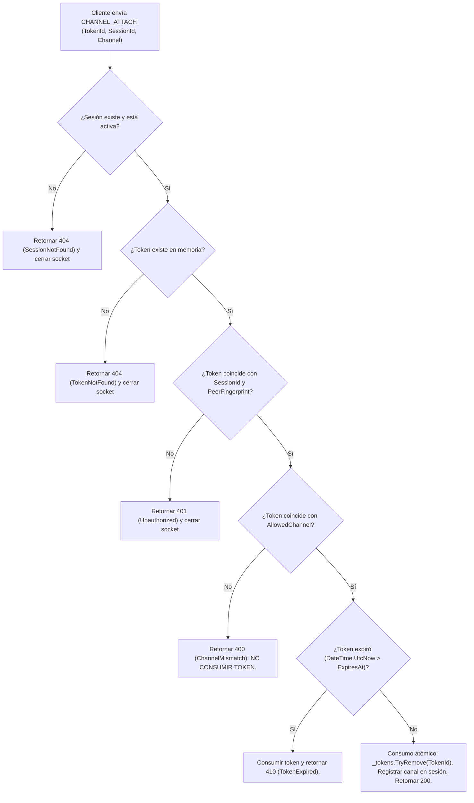

# ADR-001: Arquitectura de Seguridad de Sesión, Autenticación Mutua (mTLS) y Emparejamiento en LanScreenShare

* **Estado:** Propuesto (Revisión 4 — Corrección Focalizada: Protocolo SAS de Comparación de Identidades)
* **Fecha:** 2026-11-04
* **Rama:** `feature/ui-and-architecture-refinement`
* **Módulos afectados:** `LanScreenShare.Core`, `LanScreenShare.Network`, `LanScreenShare.Desktop`
* **Decisores:** Equipo de Arquitectura de LanScreenShare

---

## 1. Contexto y Problema

LanScreenShare opera mediante una topología de red local multi-puerto sobre TCP/UDP:
* **Puerto 5000 (UDP):** Descubrimiento y anuncio de presencia en la subred.
* **Puerto 5001 (TCP):** Transmisión de vídeo (fotogramas H.264 / JPEG con encabezado binario de 32 bytes) y señalización de sesión.
* **Puerto 5002 (TCP):** Transmisión de audio (muestras PCM sin comprimir).
* **Puerto 5003 (TCP):** Control remoto bidireccional (eventos de ratón y teclado inyectados en Windows mediante `SendInput`).

### Vulnerabilidades del Modelo Actual
1. **Canales TCP huérfanos y desvinculados:** Cada puerto escucha de forma independiente. No existe correlación criptográfica entre los sockets. Un cliente puede conectarse a 5003 sin estar conectado a 5001 ni 5002.
2. **Ausencia de autenticación e integridad en el transporte:** El tráfico viaja en texto claro sin cifrado TLS. Cualquier dispositivo en la LAN con un analizador de red puede capturar la pantalla y el micrófono del anfitrión.
3. **Identificación efímera y falsificable:** La identidad del cliente se reduce a la cadena `RemoteEndPoint` (`IP:puerto`). La aprobación visual en UI aprueba una dirección IP, pero no autentica la identidad criptográfica del par.
4. **Falta de exclusividad de control:** Si dos clientes acceden a 5003, ambos pueden emitir `SendInput` simultáneamente, provocando colisiones impredecibles en el escritorio.
5. **Riesgo de entradas atascadas:** La desconexión intempestiva del controlador puede dejar teclas modificadoras o botones de ratón presionados en el sistema operativo del anfitrión.

---

## 2. Modelo de Amenazas y Alcance

### 2.1 Amenazas Contempladas y Mitigadas
| Vector de Amenaza | Descripción | Mitigación en este ADR |
| :--- | :--- | :--- |
| **T1: Suplantación de identidad (Spoofing)** | Un equipo de la LAN finge ser un visor legítimo o suplanta su dirección IP mediante ARP spoofing. | Certificados X.509 por dispositivo con mTLS 1.3 y emparejamiento con *Certificate Pinning* de huella canónica SHA-256. |
| **T2: Interceptación y espionaje (Eavesdropping)** | Un tercero en la misma red Wi-Fi/cableada captura paquetes de vídeo o audio. | Cifrado obligatorio TLS 1.3 con suites modernas (`TLS_AES_256_GCM_SHA384`, `TLS_CHACHA20_POLY1305_SHA256`). |
| **T3: Conexión de control no autorizada** | Un atacante se conecta directamente al puerto 5003 sin pasar por el flujo de vídeo para inyectar entradas. | El puerto 5003 no admite datos sin presentar un `ChannelAttachmentToken` atómico de un solo uso derivado de una sesión mTLS autorizada. |
| **T4: Ataque de repetición (Replay)** | Reenvío de paquetes de control capturados para ejecutar comandos no deseados. | Números de secuencia monotónicos `ulong` por sesión y protección anti-replay inherente de TLS 1.3. |
| **T5: Confusión de sesión multicliente** | Eventos de múltiples visores entremezclados en el control del anfitrión. | Principio de *Single Active Controller* (exclusividad estricta garantizada por bloqueo atómico). |
| **T6: Man-in-the-Middle (MitM) en primer contacto** | Sustitución de identidad durante el descubrimiento o emparejamiento inicial. | Protocolo SAS (Short Authentication String) de 6 dígitos derivado de la comparación canónica de identidades y nonces verificados en mTLS. |

### 2.2 Amenazas Fuera de Alcance (Out of Scope)
* **Endpoints comprometidos:** Si el visor emparejado contiene malware o un troyano con acceso a su clave privada, este ADR no puede distinguir comandos legítimos del usuario de comandos inyectados por el malware en ese visor.
* **Acceso físico al anfitrión:** Si un atacante tiene acceso físico al teclado y pantalla del anfitrión, puede aprobar solicitudes o manipular la configuración local.
* **Ataques a nivel de kernel:** Restricciones de UIPI o anti-cheats a nivel de Ring 0 en Windows exceden las capacidades del protocolo de red de LanScreenShare.

---

## 3. Decisión Arquitectónica: Estándares y Autoridad Central

1. **Transporte Seguro Estándar (TLS 1.3 mTLS):**
   * Se rechaza expresamente diseñar criptografía propietaria o protocolos HMAC por paquete caseros.
   * Todos los puertos TCP (5001, 5002, 5003) negocian obligatoriamente **TLS 1.3 mediante `System.Net.Security.SslStream`**.
   * **Sin Fallback:** Si un cliente intenta conectarse sin ClientHello TLS 1.3, el servidor rechaza y cierra el socket inmediatamente.
2. **Autoridad Central de Sesión (`SessionAuthority`):**
   * Reside en `LanScreenShare.Core`. Es la única entidad facultada para crear, asociar y revocar sesiones.
   * Los servidores TCP no toman decisiones de autorización aisladas; delegan estrictamente en `SessionAuthority`.

---

## 4. Identidad Criptográfica, Ciclo de Vida y Recuperación Segura

### 4.1 Abstracción de Almacenamiento de Claves
Para no acoplar `LanScreenShare.Core` a Windows ni a DPAPI, se define una abstracción:
```csharp
namespace LanScreenShare.Core.Security
{
    public interface IIdentityKeyStorage
    {
        Task<X509Certificate2> GetOrCreateIdentityCertificateAsync();
        Task ResetIdentityAsync();
    }
}
```
* **Implementación Windows (`WindowsDpapiIdentityKeyStorage`):**
  * Almacena el certificado en `%LocalAppData%\LanScreenShare\security\identity.pfx`.
  * La clave privada se protege mediante **DPAPI** de Windows con `DataProtectionScope.CurrentUser`.
* **Generación:** Al primer arranque, se genera un par de claves asimétricas **ECDSA (curva secp256r1 / NIST P-256)** con certificado autofirmado X.509v3, vigencia de 2 años, y extensiones EKU `ClientAuth` (`1.3.6.1.5.5.7.3.2`) + `ServerAuth` (`1.3.6.1.5.5.7.3.1`).
* **Política de Falla Segura ante Corrupción (Sin Regeneración Silenciosa):**
  * Si el perfil de Windows se corrompe o cambia de usuario provocando `CryptographicException` al leer el PFX:
    * **La aplicación NO regenera silenciosamente la identidad.**
    * Se bloquea el inicio del servicio y se notifica en UI:
      > *"Fallo de Integridad Criptográfica: La clave privada del dispositivo no pudo descifrarse con el perfil actual de Windows.*
      > *[Reintentar] [Restablecer Identidad (Se invalidarán todos los emparejamientos previos)]"*
    * Solo mediante la confirmación explícita del usuario se genera una clave nueva y se purgan los registros antiguos.

---

## 5. El Emparejamiento Inicial frente a mTLS: Las Dos Fases de Conexión

Para resolver la aparente contradicción entre la validación estricta de mTLS y la necesidad de conectar un dispositivo aún no emparejado:

### 5.1 Fase A: Modo de Emparejamiento Provisional (`ProvisionalPairing`)
1. **Intención de Emparejamiento:** El visor inicia la conexión al puerto 5001 marcando el prefijo de intención de emparejamiento.
2. **Comportamiento en `RemoteCertificateValidationCallback`:**
   * En este modo provisional, el anfitrión valida que el certificado sea sintácticamente correcto, tenga fechas válidas y el EKU adecuado, pero **NO exige que la huella esté en `IPairedDeviceStore`**.
3. **Restricción Absoluta de Capacidades:**
   * La sesión se crea con estado `SessionState.ProvisionalPairing`.
   * **Cero streaming de vídeo, cero audio, cero control remoto.**
   * Los únicos mensajes procesados son `PAIRING_INIT`, `PAIRING_CHALLENGE`, `PAIRING_CONFIRM`, `PAIRING_ABORT`.
4. **Protección contra DoS en Emparejamiento:**
   * **Cola de solicitudes pendientes:** Se admiten hasta 3 solicitudes de emparejamiento simultáneas en cola de espera.
   * **Timeout de Inactividad:** 30 segundos por solicitud; si el cliente no responde, el socket se libera.
   * **Cancelación en UI:** El anfitrión dispone de un botón `[Cancelar]` en la tarjeta de emparejamiento para descartar inmediatamente la solicitud.

### 5.2 Fase B: Modo de Sesión Normal (Dispositivos Emparejados)
* En conexiones ordinarias, `RemoteCertificateValidationCallback` aplica **Certificate Pinning estricto**:
  * Si la huella SHA-256 del certificado del visor no existe en `IPairedDeviceStore` o está en la lista de revocados, el callback retorna `false` y el handshake TLS se interrumpe inmediatamente a nivel de transporte.

---

## 6. Protocolo SAS de Comparación de Identidades (Opción B Seleccionada)

### 6.1 Evaluación Comparativa y Selección de Alternativa
1. **Opción A (TLS Exporter RFC 9266):**
   * *Diagnóstico:* `SslStream.GetTlsExporter` no existe en .NET 9 BCL. Implementarlo exigiría P/Invoke nativo a Windows SChannel (`QueryContextAttributes` con `SECPKG_ATTR_KEYING_MATERIAL`), rompiendo la portabilidad y añadiendo una superficie de fallo nativa considerable.
2. **Opción B (Protocolo de Comparación de Identidades Criptográficas - SELECCIONADA):**
   * *Diagnóstico:* Utiliza 100% APIs gestionadas estándar de .NET 9 (`SHA256` y `X509Certificate2.RawData`).
   * *Fundamento de Seguridad:* Durante el handshake mTLS 1.3, el protocolo TLS ya exige la prueba criptográfica de posesión de las claves privadas de ambos extremos mediante el mensaje `CertificateVerify`. El protocolo SAS añade la **vinculación fuera de banda para autenticar humanamente que las identidades intercambiadas son las de los dos equipos legítimos**.

### 6.2 Construcción Matemática del SAS
1. **Generación de Nonces Criptográficos:**
   * El anfitrión genera $N_{\text{Host}} \in \{0,1\}^{128}$ usando `RandomNumberGenerator.GetBytes(16)`.
   * El visor genera $N_{\text{Viewer}} \in \{0,1\}^{128}$ usando `RandomNumberGenerator.GetBytes(16)`.
2. **Transcripción Canónica:**
   $$\text{Transcript} = \text{ProtocolVersion (uint32)} \parallel \text{DER}(C_{\text{Host}}) \parallel \text{DER}(C_{\text{Viewer}}) \parallel N_{\text{Host}} \parallel N_{\text{Viewer}}$$
3. **Derivación del Código de Comparación:**
   $$\text{Hash} = \text{SHA256}(\text{Transcript})$$
   $$\text{SAS\_Code} = \text{Int32}(\text{Hash}[0..3]) \pmod{1\,000\,000} \quad \text{(Formato visual: 6 dígitos: } XXX\text{-}XXX\text{)}$$

### 6.3 Demostración de Resistencia Anti-MitM
* Si un atacante activo intenta interceptar la conexión provisional, debe terminar dos handshakes TLS 1.3 independientes:
  * Conexión 1 (Atacante ↔ Anfitrión): El atacante presenta $C_{\text{Atacante\_Viewer}}$. El anfitrión calcula $\text{Transcript}_H$ usando $\text{DER}(C_{\text{Atacante\_Viewer}})$.
  * Conexión 2 (Visor ↔ Atacante): El atacante presenta $C_{\text{Atacante\_Host}}$. El visor calcula $\text{Transcript}_V$ usando $\text{DER}(C_{\text{Atacante\_Host}})$.
* Dado que el atacante no puede falsificar la clave privada de ninguno de los dos extremos legítimos, $C_{\text{Atacante}} \neq C_{\text{Legítimo}}$.
* Por tanto, $\text{Transcript}_H \neq \text{Transcript}_V \implies \text{SAS\_Code}_H \neq \text{SAS\_Code}_V$.
* Los códigos de 6 dígitos en pantalla **diferirán de forma garantizada**, permitiendo a los usuarios detectar la interceptación y abortar el emparejamiento.

---

## 7. Validación Rigurosa de Certificados

La función `ValidateRemoteCertificate` valida en cada conexión:
1. `SslStream.SslProtocol == SslProtocols.Tls13`.
2. Vigencia: `NotBefore <= DateTime.UtcNow <= NotAfter`.
3. Extensiones EKU: debe contener `ClientAuth` (`1.3.6.1.5.5.7.3.2`) en el visor o `ServerAuth` (`1.3.6.1.5.5.7.3.1`) en el anfitrión.
4. Longitud de clave: Mínimo ECDSA P-256 o RSA 2048 bits.
5. Huella SHA-256: contrastada contra `IPairedDeviceStore`.

---

## 8. Consumo Atómico y Seguro de `ChannelAttachmentToken`

Para evitar que una solicitud maliciosa o malformada invalide un token legítimo:



* **Preservación ante error de canal:** Si un token expedido para Audio se presenta por error en el puerto 5003, **no se destruye**. Se rechaza la solicitud pero el token permanece disponible para su canal legítimo hasta que expire.
* **Invalidación en cascada:** Al cerrar la sesión primaria 5001, todos los tokens asociados a su `SessionId` se purgan inmediatamente.

---

## 9. `InjectedInputTracker`: Coherencia, Serialización y Resultados Parciales

1. **Gestión de Resultados Parciales de `SendInput`:**
   * En Windows, `SendInput` devuelve la cantidad de eventos efectivamente inyectados:
     ```csharp
     uint inserted = SendInput((uint)events.Length, events, Marshal.SizeOf<INPUT>());
     ```
   * Solo los primeros `inserted` eventos se incorporan al conjunto de teclas/botones activos en el tracker.
2. **Serialización Estricta:**
   * Las operaciones de inyección y el estado del tracker están protegidos por un `lock (_inputLock)` para prevenir condiciones de carrera entre hilos de lectura y cancelación.
3. **Liberación Idempotente Exclusiva:**
   * Ante desconexión o revocación, el tracker emite `KEYUP` / `MOUSEBUTTONUP` **únicamente sobre las teclas registradas que LanScreenShare insertó**.
   * Se prohíbe terminantemente la emisión ciega de modificadores universales. El teclado físico del anfitrión no es interferido.

---

## 10. Protocolo LSI2 y Compatibilidad

* **Formato del Encabezado LSI2 (28 bytes):**
  * `Magic` (4 bytes): `0x4C534932` ("LSI2").
  * `SequenceNumber` (8 bytes, `ulong` monotónico).
  * `Timestamp` (8 bytes, `ulong` monotónico via `Stopwatch.GetTimestamp()`).
  * `Payload` (8 bytes): EventType (1), Button (1), WheelDelta (2), KeyCode (4).
* **Rechazo de Versiones Anteriores (Sin Fallback):**
  * Si un cliente intenta conectarse con el magic anterior `LSI1` (20 bytes), el anfitrión responde con error de protocolo `400 BadProtocolVersion` y desconecta el socket.

---

## 11. Límites de Recursos y Protección Anti-DoS

| Recurso | Límite Estricto | Acción ante Exceso |
| :--- | :--- | :--- |
| **Señalización JSON (5001)** | Máximo **16 KB** | Cierre inmediato del socket. |
| **Paquete de Control (5003)** | Exactamente **28 bytes** | Descarte y desconexión si el magic no coincide. |
| **Timeout de Handshake mTLS** | **10 segundos** | Destrucción del socket. |
| **Timeout de Emparejamiento Provisional** | **30 segundos** por solicitud | Cancelación y cierre de socket. |
| **Timeout de Token de Asociación** | **15 segundos** | Rechazo con código `410`. |
| **Límite de Anuncios UDP 5000** | Máx. 1 paquete / seg por host | Visor ignora ráfagas > 5 paquetes / seg por IP. |
| **Rendimiento TLS 1.3** | *Pendiente de benchmark empírico* | Se medirá formalmente en la Fase de Rendimiento. |

---

## 12. Decisiones Cerradas, Abiertas y Riesgos Residuales

### Decisiones Cerradas
* mTLS 1.3 con `SslStream` sin protocolos criptográficos caseros.
* Emparejamiento SAS de 6 dígitos mediante comparación canónica de identidades y nonces (Opción B).
* Separación formal entre *Emparejamiento Provisional* y *Sesión Normal*.
* Token de canal con validación de tipo previa al consumo.
* `InjectedInputTracker` con gestión de resultados parciales de `SendInput`.
* Rechazo estricto de clientes LSI1.

### Decisiones Abiertas (Futuras)
* Implementación de Acceso Desatendido por PIN (PAKE).
* Almacén de claves nativo para Linux (`libsecret`) y macOS (`Keychain`).

### Riesgos Residuales
* La seguridad del control remoto descansa en la verificación visual humana del código SAS durante el primer contacto.
* Si el anfitrión pierde su clave privada DPAPI, se requerirá un restablecimiento manual que exigirá re-emparejar a los visores.
