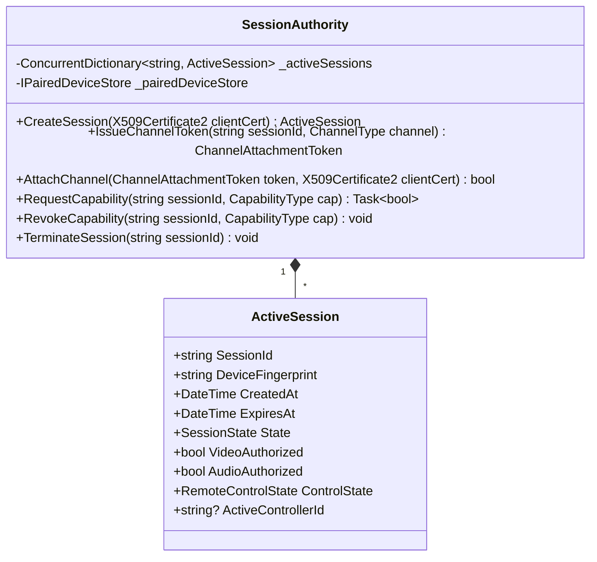
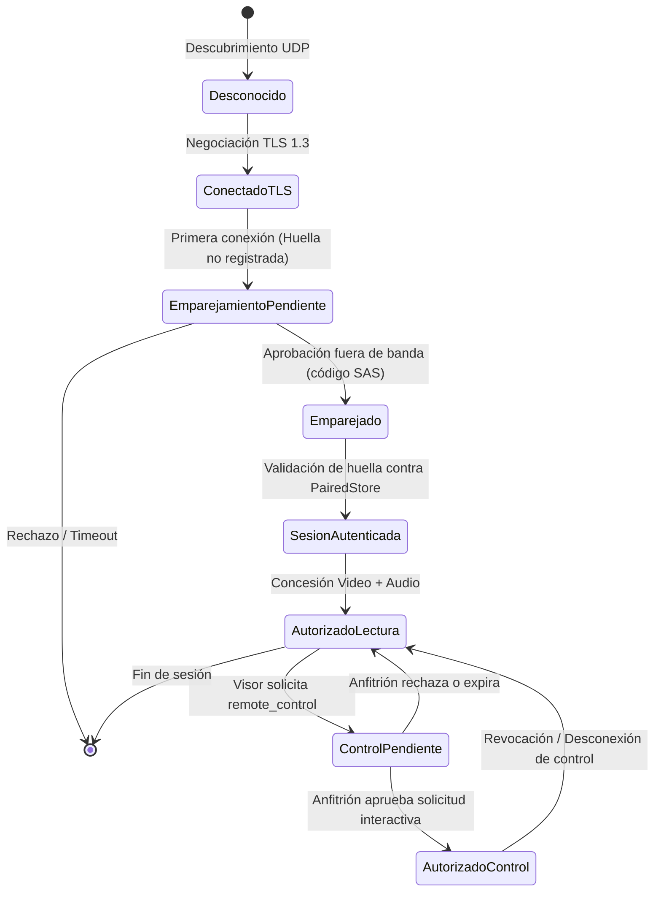

# ADR-001: Arquitectura de Seguridad de Sesión, Autenticación Mutua (mTLS) y Emparejamiento en LanScreenShare

* **Estado:** Propuesto (En revisión técnica)
* **Fecha:** 2026-11-04
* **Rama:** `feature/ui-and-architecture-refinement`
* **Módulos afectados:** `LanScreenShare.Core`, `LanScreenShare.Network`, `LanScreenShare.Desktop`
* **Decisores:** Equipo de Arquitectura de LanScreenShare

---

## 1. Contexto y Problema

LanScreenShare opera actualmente mediante una topología de red local multi-puerto sobre TCP:
* **Puerto 5000 (UDP):** Descubrimiento y anuncio de presencia en la subred.
* **Puerto 5001 (TCP):** Transmisión de vídeo (fotogramas H.264 / JPEG con encabezado de 32 bytes).
* **Puerto 5002 (TCP):** Transmisión de audio (muestras PCM sin comprimir).
* **Puerto 5003 (TCP):** Control remoto bidireccional (eventos de ratón y teclado inyectados en Windows mediante `SendInput`).

### Vulnerabilidades del Modelo Actual
1. **Canales TCP huérfanos y desvinculados:** Cada uno de los tres puertos escucha independientemente. No existe correlación criptográfica entre los sockets. Un cliente puede conectarse a 5003 sin estar conectado a 5001 ni 5002.
2. **Ausencia de autenticación e integridad en el transporte:** El tráfico viaja en texto claro sin cifrado TLS. Cualquier dispositivo en la LAN con un analizador de red puede capturar la pantalla y el micrófono del anfitrión.
3. **Identificación efímera y falsificable:** La identidad del cliente se reduce a la cadena `RemoteEndPoint` (`IP:puerto`). La aprobación visual en UI aprueba una dirección IP, pero no autentica la identidad criptográfica del par.
4. **Falta de exclusividad de control:** Si dos clientes acceden a 5003, ambos pueden emitir `SendInput` simultáneamente, provocando colisiones impredecibles en el escritorio.
5. **Riesgo de teclas/botones atascados:** La pérdida abrupta de conexión del controlador no garantiza la liberación de teclas modificadoras (Ctrl, Alt, Shift) ni botones del ratón en el sistema operativo del anfitrión.

---

## 2. Modelo de Amenazas

| Vector de Amenaza | Descripción | Impacto | Mitigación en este ADR |
| :--- | :--- | :--- | :--- |
| **T1: Suplantación de identidad (Spoofing)** | Un equipo de la LAN finge ser un visor legítimo o suplanta su dirección IP mediante ARP spoofing. | Crítico | Certificados X.509 por dispositivo con mTLS 1.3 y emparejamiento con validación de huella (*pinning*). |
| **T2: Interceptación y espionaje (Eavesdropping)** | Un tercero en la misma red Wi-Fi/cableada captura los paquetes de vídeo y audio. | Alto | Cifrado obligatorio TLS 1.3 con conjuntos de cifrado modernos (AES-GCM / ChaCha20-Poly1305). |
| **T3: Conexión de control no autorizada** | Un atacante se conecta directamente al puerto 5003 sin pasar por el flujo de vídeo para inyectar entradas. | Crítico | El puerto 5003 no admite datos sin presentar un token de canal atómico de un solo uso derivado de una sesión mTLS autorizada. |
| **T4: Ataque de repetición (Replay)** | Reenvío de paquetes de control capturados para ejecutar comandos no deseados. | Alto | Números de secuencia monotónicos por sesión validados en cada mensaje y protección anti-replay inherente de TLS 1.3. |
| **T5: Confusión de sesión multicliente** | Eventos de múltiples visores entremezclados en el control del anfitrión. | Medio | Principio de *Single Active Controller* (exclusividad estricta y bloqueo de concurrencia). |
| **T6: Man-in-the-Middle (MitM) en primer contacto** | Sustitución de identidad durante el descubrimiento o emparejamiento inicial. | Crítico | Canal fuera de banda (código numérico corto / comparación de huella SAS) verificado por ambos usuarios. |

---

## 3. Decisión Arquitectónica

### 3.1 Criptografía y Transporte: TLS 1.3 con Autenticación Mutua (mTLS)
* Se rechaza expresamente el diseño de protocolos criptográficos propietarios.
* Todas las conexiones TCP en los puertos 5001, 5002 y 5003 deberán negociar **TLS 1.3 mediante `System.Net.Security.SslStream`**.
* Se exige **autenticación mutua (mTLS)**: tanto el anfitrión como el visor presentan un certificado de identidad.
* La validación no se apoya en CAs de terceros, sino en **Certificate Pinning estricto** contrastado contra la lista local de dispositivos emparejados.

### 3.2 Autoridad Central de Sesión en el Anfitrión
Se define un componente central en `LanScreenShare.Core`: `SessionAuthority`. Los tres servidores de red consultan esta autoridad única; ninguno toma decisiones de autorización aisladas.



---

## 4. Identidad Criptográfica y Emparejamiento

### 4.1 Identidad Persistente del Dispositivo
1. **Generación de Claves:**
   * Cada instalación genera un par de claves asimétricas RSA (3072 bits) o ECDSA (secp256r1 / P-256) y un certificado X.509 autofirmado con vigencia de 2 años y propósito `ClientAuth` + `ServerAuth`.
2. **Protección de la Clave Privada en Reposo:**
   * En Windows, la clave privada y el almacén local se exportan cifrados con **DPAPI** (`DataProtectionScope.CurrentUser`), garantizando que solo el usuario actual de Windows pueda descifrarlos.
   * Ruta de almacenamiento: `%LocalAppData%\LanScreenShare\security\identity.pfx` (protegido con DPAPI).
3. **Huella Canónica (Fingerprint):**
   * SHA-256 del certificado binario en formato DER (`cert.GetCertHash(HashAlgorithmName.SHA256)`).
   * Representación humana: Formato hexadecimal de 8 grupos (ej. `3A:7F:B2:91:...`).

### 4.2 Distinción Formal de Estados de Dispositivo y Sesión
Para evitar ambigüedades, el sistema define formalmente los siguientes estados:



* **Dispositivo Desconocido:** Presenta un certificado TLS válido sintácticamente, pero su huella no existe en el registro local.
* **Dispositivo Emparejado (Paired):** Su huella está almacenada en `trusted_devices.json` (cifrado con DPAPI).
* **Sesión Autenticada:** Conexión mTLS completada donde la huella del cliente coincide con un dispositivo emparejado.
* **Sesión Autorizada para Visualización:** Dispone de permiso para consumir el canal 5001 y 5002.
* **Sesión Autorizada para Control:** Ha recibido autorización explícita para inyectar entradas en el puerto 5003.

### 4.3 Protocolo de Emparejamiento Inicial (Prevención MitM)
Para evitar que un intermediario sustituya certificados durante la primera conexión:
1. El anfitrión muestra en pantalla un **Código de Verificación SAS (Short Authentication String)** derivado de:
   $$\text{SAS} = \text{Truncate6Digits}(\text{HMAC-SHA256}(\text{HostCertFingerprint} \parallel \text{ClientCertFingerprint}, \text{Nonce}))$$
2. El visor muestra el mismo SAS calculado localmente sobre los certificados de la sesión TLS establecida.
3. El anfitrión debe pulsar `[Confirmar Código Coincidente]` antes de registrar la huella en el almacén de confianza.

---

## 5. Protocolo de Señalización y Asociación de Canales

### 5.1 Canal Primario (Puerto 5001)
El puerto 5001 opera como canal de señalización inicial antes de comenzar el streaming de vídeo:
1. Negociación TLS 1.3 con mTLS.
2. Intercambio de mensajes estructurados en JSON delimitados por longitud (Prefijo entero de 4 bytes en Big-Endian):

#### Estructura de Mensajes Versionados
```json
{
  "protocol_version": 1,
  "message_id": "c4b3a290-1234-4a5b-9f0e-1a2b3c4d5e6f",
  "type": "SESSION_INIT",
  "timestamp": 1730682000000,
  "payload": {
    "client_name": "Laptop-Sala",
    "requested_capabilities": ["video_receive", "audio_receive"]
  }
}
```

```json
{
  "protocol_version": 1,
  "message_id": "e8f7d6c5-5678-4a5b-9f0e-7a8b9c0d1e2f",
  "type": "SESSION_ACCEPT",
  "timestamp": 1730682000050,
  "payload": {
    "session_id": "99b38cf7-2345-4cde-81a2-3b4c5d6e7f8a",
    "granted_capabilities": ["video_receive", "audio_receive"],
    "audio_attachment_token": "a1b2c3d4-token-audio",
    "control_attachment_token": "f5e4d3c2-token-control"
  }
}
```

### 5.2 Asociación Segura de Canales Secundarios (5002 y 5003)
Para evitar que el conocimiento de un `SessionId` permita conexiones huérfanas:
1. El anfitrión emite un **`ChannelAttachmentToken`**:
   * Token aleatorio criptográfico (128 bits / 16 bytes en Base64).
   * **Vinculado estrictamente al tipo de canal** (`Audio` o `Control`).
   * **Consumo atómico y de un solo uso (*Single-Use*):** Se invalida en memoria en cuanto se consume.
   * **Caducidad estricta:** Expira a los 15 segundos si no se usa.
2. Al conectar al puerto 5002 o 5003 vía mTLS, el visor debe enviar como primer paquete:
   ```json
   {
     "protocol_version": 1,
     "type": "CHANNEL_ATTACH",
     "session_id": "99b38cf7-2345-4cde-81a2-3b4c5d6e7f8a",
     "channel": "remote_control",
     "attachment_token": "f5e4d3c2-token-control"
   }
   ```
3. El servidor verifica:
   * Que el socket pertenezca a la misma huella mTLS de la sesión.
   * Que el token exista, no haya expirado y corresponda al canal solicitado.
   * Elimina el token inmediatamente. Si falla, cierra el socket de inmediato.

---

## 6. Autorización, Exclusividad y Revocación del Control Remoto

### 6.1 Aprobación Interactiva Obligatoria
* En cada sesión, la solicitud de control remoto (`CAPABILITY_REQUEST: remote_control`) dispara el diálogo visual en el anfitrión con cuenta atrás de 25 segundos.
* **Decisión explícita:** Se descarta el modo "Acceso desatendido por PIN" para esta fase. Toda sesión de control requiere interacción humana del anfitrión.

### 6.2 Principio de Controlador Único (*Single Active Controller*)
* El anfitrión mantiene la variable `_activeControllerSessionId`.
* Si un segundo visor solicita control remoto mientras ya existe un controlador activo, el anfitrión responde inmediatamente `CAPABILITY_REJECTED` con código `409 Conflict (Another controller is active)`.

### 6.3 Mecanismo de Revocación y Limpieza de Entradas (`SendInput`)
Para mitigar la persistencia de teclas o clics pulsados tras una revocación o desconexión abrupta:
1. **Rastreador de Estado Inyectado (`InjectedInputTracker`):**
   * Cada vez que `WindowsInputSimulatorService` ejecuta una pulsación hacia abajo (`KeyDown` o `MouseDown`), registra la tecla virtual (`VK`) o el botón en un `HashSet<ushort>` concurrente.
   * Al recibir `KeyUp` o `MouseUp`, lo elimina del registro.
2. **Procedimiento de Desconexión / Revocación Forzada:**
   Al presionar el botón `[Revocar Control Remoto]` o ante una excepción de socket en el puerto 5003:
   * Se marca `RemoteControlAuthorized = REVOKED`.
   * Se cancela y cierra el `SslStream` del puerto 5003.
   * Se vacía inmediatamente la cola de eventos en tránsito.
   * Se ejecuta un barrido atómico sobre el `InjectedInputTracker` emitiendo eventos `KEYEVENTF_KEYUP` y `MOUSEEVENTF_*UP` para cada tecla o botón que figure como presionado.
   * Se emite una liberación de seguridad para modificadores universales: `VK_LCONTROL`, `VK_RCONTROL`, `VK_LSHIFT`, `VK_RSHIFT`, `VK_LMENU` (Alt), `VK_RMENU`, `VK_LWIN`, `VK_RWIN`.

---

## 7. Protección del Canal de Descubrimiento UDP (Puerto 5000)

* El puerto UDP 5000 **nunca concede acceso ni ejecuta acciones sensibles**.
* Su único propósito es anunciar la presencia del anfitrión en la LAN.
* Para mitigar suplantación de nombres o inundación de anuncios falsos:
  * El paquete de anuncio UDP incluirá: `HostName`, `IP`, `Port (5001)`, `HostCertFingerprint`, `ProtocolVersion`, y un `Timestamp` (con ventana de validez de 5 segundos para descartar anuncios antiguos).
  * El visor verifica la huella recibida contra su lista de dispositivos emparejados antes de mostrar la etiqueta de "Dispositivo conocido".

---

## 8. Almacenamiento, Renovación y Eliminación de Dispositivos

1. **Estructura del Almacén de Confianza:**
   * Archivo: `%LocalAppData%\LanScreenShare\security\trusted_devices.json`.
   * Contenido cifrado en reposo con DPAPI:
     ```json
     [
       {
         "device_id": "a9f8b7c6-...",
         "device_name": "Laptop-Gino",
         "public_key_fingerprint": "3A:7F:B2:91:...",
         "paired_at": 1730682000000,
         "last_seen_at": 1730685600000
       }
     ]
     ```
2. **Eliminación y Revocación de Emparejamiento:**
   * La interfaz del anfitrión dispondrá de un panel de "Dispositivos Emparejados" donde el usuario podrá revocar y eliminar cualquier dispositivo con un clic, eliminando su huella del almacén DPAPI.
3. **Renovación y Reinstalación:**
   * Si un usuario reinstala el sistema operativo o borra la carpeta de datos, se genera un nuevo certificado y se invalida la relación previa, requiriendo un nuevo emparejamiento con código SAS para restablecer la confianza.

---

## 9. Plan de Verificación y Pruebas de Seguridad

| Tipo de Prueba | Escenario de Prueba | Resultado Esperado |
| :--- | :--- | :--- |
| **Positiva** | Visor emparejado conecta a 5001 con mTLS, solicita capacidades y control con aprobación interactiva. | Sesión activa, video/audio streaming y control fluido con 1 solo controlador. |
| **Negativa: Dispositivo desconocido** | Un cliente con certificado autofirmado no emparejado intenta conectar a 5001. | Conexión TLS rechazada en el handshake de validación de huella. |
| **Negativa: Canal huérfano** | Un cliente intenta abrir socket directo al puerto 5003 sin token de asociación. | El anfitrión cierra el socket inmediatamente sin procesar entradas. |
| **Negativa: Token reutilizado** | Un cliente intenta usar el mismo `attachment_token` dos veces en el puerto 5003. | Segundo intento rechazado y socket cerrado (consumo de un solo uso). |
| **Negativa: Inyección no autorizada** | Cliente conectado a 5003 envía paquetes antes de que el anfitrión apruebe en la UI. | Paquetes descartados y socket cerrado de inmediato. |
| **Concurrencia: Segundo controlador** | Un segundo visor solicita control mientras el primero está controlando. | Solicitud rechazada con código de conflicto; control no se comparte. |
| **Resiliencia: Desconexión abrupta** | Se desconecta el cable de red del visor mientras mantiene presionada la tecla 'Shift'. | El anfitrión detecta caída de socket, vacía la cola y emite `KEYUP` para 'Shift'. |

---

## 10. Riesgos Residuales y Decisiones Diferidas

1. **Acceso Desatendido mediante PIN:** Se excluye intencionadamente de esta fase. Cualquier futura implementación deberá basarse en un intercambio PAKE (ej. SPAKE2+ o SRP-6a) y límites estrictos contra ataques de fuerza bruta.
2. **Tráfico fuera de LAN / NAT Traversal:** LanScreenShare está diseñado exclusivamente para subred local / VPN punto a punto. No se contempla servidor de retransmisión (*relay* / TURN) ni traversal STUN/ICE en esta versión.
3. **Carga en CPU por TLS:** TLS 1.3 sobre TCP añade una sobrecarga despreciable (< 2% de CPU) en procesadores modernos con instrucciones AES-NI en red local de 1 Gbps.

---

## 11. Consecuencias y Próximos Pasos

### Ventajas
* Conexión blindada contra interceptación y suplantación en redes LAN domésticas o empresariales.
* Separación clara de responsabilidades: los servidores TCP se limitan a enrutar; la `SessionAuthority` decide.
* Imposibilidad técnica de inyectar entradas en el anfitrión sin consentimiento explícito y autenticado.

### Compromisos
* Incremento de complejidad en el código de red (`LanScreenShare.Network`).
* Introducción del paso de emparejamiento inicial en la experiencia de usuario (intercambio SAS).

### Próximo Paso Aprobado
Esperar la revisión y aprobación formal de este ADR antes de escribir código en `TcpStreamServer`, `TcpAudioServer` o `TcpControlServer`.
